# Implementation Workflow and Technology Stack

**Project:** AI-Driven Quantum-Safe Cryptography Assessment and Migration Assistant  
**Architecture source of truth:** `PHASE_1_ARCHITECTURE_AND_DESIGN.md`  
**Purpose:** Translate the approved Phase 1 design into an implementation structure and build sequence.

---

## 1. System Architecture

Implement the three application tiers and persistence/worker services specified in Phase 1:

1. **React frontend:** project workflows, scan status, findings, CBOM, risk/CARS views, recommendations, benchmarks, validation, and reports.
2. **Node.js / Express gateway:** authentication and RBAC, project/repository management, safe upload orchestration, scan dispatch, result APIs, and report downloads.
3. **Python / FastAPI analyzer:** safe extraction, discovery, CBOM generation, weakness/vulnerability correlation, quantum risk, CARS, recommendations, benchmarks, ML decision support, roadmap, and migration diffing.
4. **PostgreSQL:** normalized persistence for users, projects, repositories, scan jobs, findings, CBOM, intelligence records, assessments, benchmark results, model metadata, and validation.
5. **Asynchronous worker:** scan and dataset jobs run outside interactive request handlers. Use a single queue technology consistently; this guide selects Celery with Redis as its broker and Python workers.

```mermaid
flowchart LR
    Browser[React + Vite UI] -->|HTTPS REST + JWT| Express[Node / Express Gateway]
    Express --> Auth[Auth, RBAC, Projects, Uploads, Reports]
    Express -->|Dispatch scan| API[Python / FastAPI Analyzer]
    API --> Queue[Redis + Celery queue]
    Queue --> Worker[Python analysis worker]
    Worker --> Extract[Safe archive extraction]
    Extract --> Discover[AST, patterns, dependencies, config]
    Discover --> CBOM[CBOM + CWE/CVE/KEV correlation]
    CBOM --> Risk[Quantum risk + prioritization + CARS]
    Risk --> ML[ML decision support]
    ML --> PQC[NIST recommendations + benchmarks + roadmap]
    PQC --> DB[(PostgreSQL)]
    Express --> DB
    Express -->|Results and status| Browser
```



### Service communication and files

- Browser requests go to Express. Express authenticates and checks ownership before project/assessment operations.
- Express records the assessment and dispatches the repository location and assessment ID to FastAPI. FastAPI enqueues a worker task and returns the job state.
- Workers update scan stages and persist normalized results to PostgreSQL. The frontend polls the Express status endpoint and retrieves result endpoints through the gateway.
- For local Docker Compose, mount a restricted upload volume into the gateway and analyzer/worker at the same configured path. Do not pass arbitrary host paths from the client. In a later distributed deployment, replace the shared volume with object storage and short-lived object references.
- Keep network access between the gateway, analyzer, worker, Redis, and database on the private service network. Do not expose Redis or PostgreSQL publicly.

---

## 2. End-to-End Assessment Workflow

1. **Register and authenticate.** Express validates input, hashes passwords with Argon2id, issues JWTs, and applies RBAC middleware.
2. **Create a project.** Store project metadata and owner/role relationships in PostgreSQL.
3. **Upload a repository archive.** Validate extension and file signature, enforce configured upload limits, write to an isolated storage location, and create a repository record.
4. **Safely extract.** Analyzer rejects path traversal, symlinks, excessive file counts, and decompression bombs. It extracts only within a dedicated temporary sandbox, and never executes repository code.
5. **Create and queue an assessment.** Express creates a `QUEUED` scan job and dispatches the assessment ID and repository reference to FastAPI. The worker reports stages such as `EXTRACTION`, `DISCOVERY`, `CBOM`, `RISK`, `RECOMMENDATIONS`, and `COMPLETED` or `FAILED`.
6. **Discover cryptography.** Run language-appropriate AST/static parsing, targeted patterns, dependency/lockfile inspection, and TLS/config analysis. Record evidence, file and line, algorithm/API, operation/purpose, parameters where available, confidence, and detector.
7. **Create CBOM.** Normalize identified cryptographic assets into internal schemas and export CycloneDX 1.6 CBOM JSON/CSV. Preserve source evidence and attribution.
8. **Map conventional weaknesses and intelligence.** Map supported findings to relevant CWE records. Correlate CVEs/KEV only when a reliable product/version match exists; do not infer that a CWE match alone is a CVE or KEV match.
9. **Calculate quantum exposure and priority.** Distinguish Shor exposure for vulnerable public-key operations from Grover-related symmetric/hash security-margin analysis. Apply a documented, configurable risk formula using quantum exposure, sensitivity, exposure, data lifetime, and controls; show its factor breakdown.
10. **Calculate CARS.** Score inventory completeness, algorithm compliance, architectural decoupling, toolchain readiness, and governance alignment; return dimension-level evidence and the aggregate 0–100 score.
11. **Run required ML decision support.** Extract documented features from findings and assessment context; run the versioned scikit-learn classifier for migration-priority/complexity assistance. Return prediction, model version, confidence or abstention, and explanation metadata separately from the deterministic finding and risk evidence.
12. **Recommend PQC and migration actions.** Use cryptographic purpose to recommend ML-KEM for key establishment and ML-DSA/SLH-DSA for signatures. Include hybrid guidance where appropriate, benchmark context where validated data exists, and an ordered migration roadmap. Do not substitute an algorithm solely because names look similar.
13. **Persist and report.** Store assessment outputs and provenance in PostgreSQL; serve paginated findings, CBOM, risk, CARS, recommendations, and downloadable JSON/PDF/CSV reports.
14. **Validate migration.** Compare baseline and migrated assessments; report resolved, remaining, and newly introduced findings, plus a transparent migration delta.

---

## 3. ML Workflow (Required Component)

ML is a required project component, consistent with Phase 1 Module 12. It assists classification and complexity estimation; it does not replace AST/API evidence, quantum-risk rules, or standards-based recommendations.

### Model lifecycle

1. Define a label rubric and target (for example, migration priority or migration complexity) aligned with the factors in the architecture. Document who labels examples and how ambiguous cases are handled.
2. Build a versioned, de-identified dataset from reviewed findings and supported source evidence. Track provenance, license, labeler, date, schema version, and permitted use. Keep CWE, CVE, KEV, and benchmark datasets isolated as specified in Phase 1; they are not interchangeable training labels.
3. Establish a transparent rules-based baseline. Train a scikit-learn classifier (for example, Logistic Regression or Random Forest) using features such as algorithm family, operation, key size, purpose, exposure, sensitivity, lifetime, detector confidence, and dependency context where known.
4. Split by repository/project to prevent near-duplicate code from crossing training and test sets. Fit preprocessing only on training folds. Use a clear train/validation/test or grouped cross-validation process.
5. Evaluate with per-class precision and recall, macro-F1, confusion matrix, class counts, and baseline comparison. Accuracy alone is not enough for imbalanced data. Record limitations and avoid generalization claims unsupported by the sample.
6. Version the preprocessing pipeline, model artifact, feature schema, label map, training data version, metrics, and code revision together. Keep model loading deterministic and fail safely if artifact/schema versions mismatch.
7. At inference, return the prediction and model version separately from rule-based risk. Use an explicit manual-review/unknown outcome for missing, low-confidence, or out-of-distribution cases.
8. Monitor reviewer feedback as candidate labels. Do not automatically retrain on unreviewed user feedback.

### UI/API presentation

Show the model output as **decision support** with its target label, confidence/abstention, model version, and concise explanation. Keep these distinct in screens and reports:

- observed cryptographic evidence;
- deterministic quantum-risk and risk-formula results;
- ML prediction;
- standards-based recommendation.

---

## 4. Technology Stack

| Layer | Phase 1 technology | Main responsibilities |
|---|---|---|
| Frontend | React 18+, Vite, Tailwind CSS, React Router, Axios, Recharts, Framer Motion, Lucide React | Dashboard, projects, uploads, scan progress, CBOM/findings, risk/CARS charts, recommendations, reports |
| Gateway | Node.js, Express, Axios, `pg`, Multer, Argon2, JWT, Helmet, CORS, express-rate-limit, dotenv | REST API, auth/RBAC, ownership checks, upload orchestration, analyzer client, reporting |
| Analysis API | Python, FastAPI, Uvicorn, Pydantic, pydantic-settings | Typed analysis endpoints and gateway-facing service contract |
| Discovery | Python `ast`, Java parser such as `javalang`, JS parser such as Esprima, targeted regex, dependency/config parsers | Static cryptographic discovery across supported languages and artifacts |
| ML/data | scikit-learn, pandas, NumPy, joblib | Feature processing, classification, evaluation, model persistence |
| Analyzer persistence | SQLAlchemy, psycopg2-binary, Alembic | ORM and schema migrations from analyzer/worker code |
| Queue | Celery + Redis | Asynchronous archive scanning and dataset ingestion |
| Database | PostgreSQL 15+ with UUID support and JSONB | Normalized application, scan, finding, intelligence, metrics, model, and validation records |
| Reports | ReportLab (Python) or PDFKit (Node) plus JSON/CSV serializers | Export scan, CBOM, and assessment results |
| Local orchestration | Docker, Docker Compose | Run frontend, gateway, analyzer, worker, Redis, and PostgreSQL consistently |
| Quality | Pytest/pytest-asyncio, Jest or Vitest, Postman/OpenAPI | Unit, API, integration, and manual workflow verification |

Use the dependency versions and supported language parser choices that are mutually compatible when scaffolding. Keep the gateway and analyzer API contract documented in OpenAPI and versioned.

---

## 5. Repository Structure

Follow the component organization in Phase 1. A practical layout is:

```text
CAPSTONE/
├── docker-compose.yml
├── .gitignore
├── README.md
├── PHASE_1_ARCHITECTURE_AND_DESIGN.md
├── IMPLEMENTATION_WORKFLOW_AND_TECH_STACK.md
├── backend/                              # Node.js / Express gateway
│   ├── package.json
│   ├── .env.example
│   ├── server.js
│   └── src/
│       ├── config/                        # DB and security config
│       ├── controllers/                   # Auth, projects, assessments, reports
│       ├── middleware/                    # Auth, upload checks, rate limiting, errors
│       ├── routes/
│       ├── services/                      # Analyzer client, report generation
│       └── utils/
├── analyzer/                              # Python FastAPI + worker
│   ├── pyproject.toml
│   ├── Dockerfile
│   ├── main.py
│   ├── app/
│   │   ├── api/                           # Scan, CBOM, risk, CARS, PQC, benchmark
│   │   ├── core/                          # Config, DB, safe unpack
│   │   ├── models/                        # SQLAlchemy persistence models
│   │   ├── schemas/                       # Pydantic request/response types
│   │   ├── services/
│   │   │   ├── discovery/                 # AST, patterns, dependencies, config
│   │   │   ├── cbom/                      # Builder and CycloneDX exporter
│   │   │   ├── intelligence/              # CWE/CVE/KEV correlation
│   │   │   ├── risk/                      # Quantum risk, prioritization, CARS
│   │   │   ├── pqc/                       # NIST knowledge and recommender
│   │   │   ├── benchmark/                 # Dataset loader and comparator
│   │   │   ├── ml/                        # Features, train/evaluate, inference
│   │   │   ├── roadmap/                   # Migration task ordering
│   │   │   └── validation/                # Before/after assessment diff
│   │   └── utils/                         # Secret redaction, logging
│   └── migrations/
├── frontend/                              # React + Vite dashboard
│   ├── package.json
│   └── src/
│       ├── api/
│       ├── components/
│       ├── pages/
│       └── charts/
├── datasets/                              # Licensed, attributed source datasets
├── model_artifacts/                       # Versioned model files and evaluation metadata
└── test-repos/                             # Safe, small fixtures with known outcomes
```

Keep secrets out of source control. Store real data provenance and license notes beside dataset ingestion code. Do not commit uploaded customer repositories or private keys.

---

## 6. API and Data Contracts

Implement the Phase 1 endpoint groups in this order:

### Gateway (Express)

- `POST /api/auth/register`, `POST /api/auth/login`
- `GET/POST /api/projects` and project detail/update operations
- `POST /api/repositories/upload/:projectId`
- `POST /api/assessments`
- `GET /api/assessments/:id/status`
- `GET /api/assessments/:id/findings`
- `GET /api/reports/:assessmentId/download`
- `POST /api/validation/compare`

### Analyzer (FastAPI)

- `POST /api/analyzer/scan` to validate and enqueue a scan
- Status/result interfaces for worker progress and completed assessments
- `GET /api/cbom/:assessmentId/export?format=cyclonedx_json|csv`
- `GET /api/risk/:assessmentId`
- `GET /api/cars/:assessmentId`
- `GET /api/recommendations/:assessmentId`
- Benchmark comparison endpoint(s) for validated benchmark records

Define shared response fields for status, assessment ID, timestamps, errors, pagination, evidence, confidence, detector, model version, and provenance. The Express gateway is the client-facing API; analyzer internals should not expose filesystem paths or secrets.

---

## 7. Build Sequence Aligned to Phase 1 Roadmap

Implement in dependency order and keep each milestone runnable:

1. **Phase 2 — Environment orchestration:** scaffold backend/analyzer/frontend; Compose PostgreSQL, Redis, and services; health checks; environment examples; shared upload volume.
2. **Phase 3 — Auth and repository management:** schema migrations, Argon2id/JWT, RBAC, project CRUD, upload validation, safe extraction, scan-job record and queue.
3. **Phase 4 — Discovery:** begin with Python AST and pattern detection; add dependency/config parsing and further languages incrementally; include evidence/confidence and secret redaction.
4. **Phase 5 — CBOM and CWE:** normalized finding schema, CycloneDX 1.6 CBOM JSON/CSV, CWE ingestion/mapping with attribution.
5. **Phase 6 — Vulnerability intelligence and quantum risk:** KEV/CVE ingestion and exact matching; explainable Shor/Grover categories.
6. **Phase 7 — Prioritization and CARS:** implement documented formula and five dimensions with factor-level evidence.
7. **Phase 8 — PQC recommendations and benchmarks:** purpose-aware FIPS 203/204/205 recommendations; ingest and validate benchmark data; keep benchmark records isolated from weakness data.
8. **Phase 9 — Required AI/ML, roadmap, and validation:** feature schema, labeled dataset provenance, baseline/model evaluation, inference API, ordered migration tasks, before/after diff.
9. **Phase 10 — React dashboard and reports:** connect UI to gateway; include status, findings, CBOM, risk/CARS, ML decision support, recommendations, benchmarks, roadmap, validation, and reports.
10. **Phase 11 — Demonstration and evaluation:** exercise end-to-end flows on safe fixtures, measure scanner precision/recall, inspect ML per-class metrics, and document limitations.

### Vertical integration rule

Although modules are listed by phase, build a thin end-to-end path early: project → upload → queued scan → Python findings → persisted result → UI display. Then enrich that path with CBOM, risk, CARS, ML, recommendation, benchmark, and report modules. This validates service boundaries before building all 18 dashboard pages.

---

## 8. Dataset and Evaluation Rules

- Keep CWE, CVE/CVEfixes, CISA KEV, and PQC benchmark sources separate, versioned, and attributed.
- Store source ID/version and confidence on mapped results. A detected algorithm is not itself a CVE, KEV entry, or confirmed conventional weakness.
- Validate dataset schema and license before ingestion. Report missing or stale data; do not fabricate dataset-backed benchmark metrics.
- For discovery, evaluate supported patterns against labeled repositories and report precision and recall, including false positives/negatives.
- For ML, document label definitions and provenance, use project-level splits, compare to a baseline, and report per-class metrics and limitations.
- Keep the model as decision support; recommendations and quantum-risk explanations must remain reviewable and standards-grounded.

---

## 9. First Demonstration Slice

The first reviewable slice should use the Phase 1 services, not replace the architecture with a single-tier demo:

1. Start the React UI, Express gateway, FastAPI analyzer/worker, Redis, and PostgreSQL through Compose.
2. Authenticate and create a project.
3. Upload a small prepared repository archive and show safe validation.
4. Queue a scan; display stage progress from the worker.
5. Display Python cryptographic detections with file/line evidence and confidence.
6. Show quantum-risk reasoning, formula breakdown, CARS dimensions, ML prediction/model metadata, and purpose-based recommendation as those modules are completed.
7. Export structured JSON/CBOM and show one report view.

If time is constrained, reduce the supported language and the number of fully implemented modules, but preserve the architectural tiers and make incomplete modules explicit. Do not claim the full fourteen-module platform is complete when only a subset is demonstrated.

